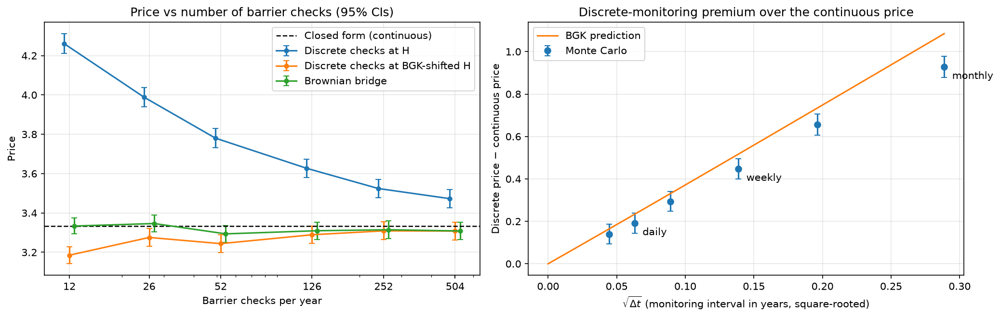
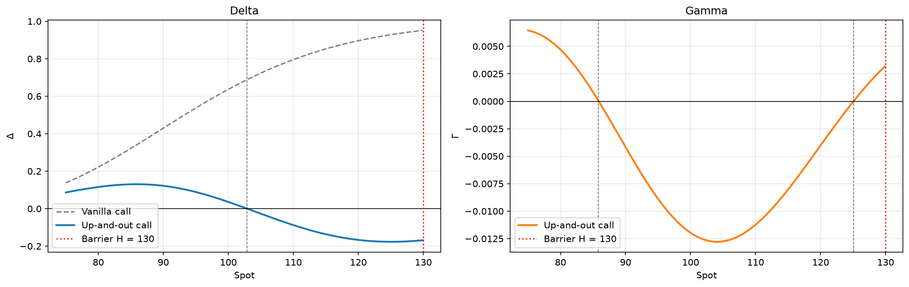
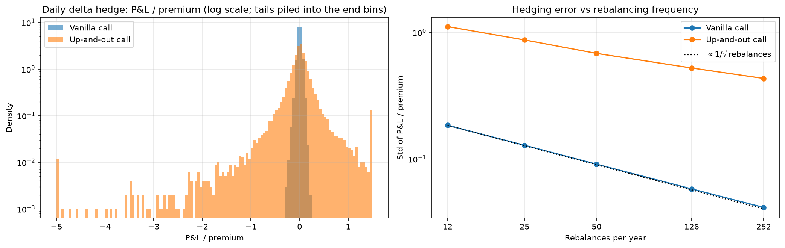

# Pricing and Hedging a Barrier Option

[](https://github.com/MilanKalajdzic/Monte-Carlo-Pricing-of-a-Barrier-Option/actions/workflows/ci.yml)

This project prices an **up-and-out call** under Black-Scholes dynamics five ways:
- the closed form
- Monte Carlo with daily barrier checks
- Brownian-bridge Monte Carlo
- a binomial tree
- the closed form with the Broadie–Glasserman–Kou continuity correction

It then delta-hedges the option to see what its Greeks mean in practice. Two findings stand out:
- **The price depends on how often the barrier is checked.** A contract checked at each
  daily close is worth about 7% more than the textbook continuous-barrier price. That gap is
  not simulation error.
- **The option is hard to hedge near the barrier.** Delta-hedging breaks down there, and
  almost all of the large hedging losses come from paths that got close to it.

The pricing code is a small tested package (`src/barrier_pricing`). The notebook
[`notebooks/barrier_option_pricing.ipynb`](notebooks/barrier_option_pricing.ipynb) tells the
story.

## Results

Base case: S₀ = K = 100, barrier H = 130, r = 5%, σ = 20%, T = 1 year. Monte Carlo uses
100,000 paths.

| Method | Contract priced | Price | 95% CI | Error vs reference | Time |
|---|---|---:|---:|---:|---:|
| Closed form (Haug 2007) | continuous barrier | 3.3329 | | reference | < 1 ms |
| Closed form at BGK-shifted barrier | daily barrier | 3.5660 | | reference | < 1 ms |
| Monte Carlo, daily checks, antithetic | daily barrier | 3.5477 | ± 0.033 | −0.018 | 166 ms |
| Brownian-bridge Monte Carlo, 12 steps | continuous barrier | 3.3319 | ± 0.029 | −0.001 | 19 ms |
| Binomial tree, mean over N = 100–400 | continuous barrier | 3.5379 | | +0.205 | 4 ms per tree |
| Binomial tree + BGK shift, same N | continuous barrier | 3.2861 | | −0.047 | 4 ms per tree |

For comparison, the vanilla call is worth 10.4506, so the knockout feature removes 68% of the
value. Times are from one laptop run and only meant for comparison.

Other findings:
- Antithetic pairs cut variance by 30%, once the standard error is computed on the pairs
  rather than on individual paths.
- Using the vanilla call as a control variate removes a further 13%. That is modest, because
  the vanilla call pays the most on exactly the paths that knock the barrier option out.

## Figures



**Monitoring matters.** Checking the barrier at H converges to the continuous price only
slowly, at a rate of √Δt. The Brownian bridge is unbiased at any grid size. The BGK formula
(right panel) predicts the discrete-vs-continuous gap well for frequent checks.



**Greeks.** Delta turns negative above S ≈ 103: closer to the barrier, a rally adds more
knockout risk than intrinsic value. Gamma changes sign twice, at about 86 and about 125.



**Hedging.** With daily rebalancing, the vanilla call's hedging error is 4% of the premium.
The barrier option's is 43%, with a heavy left tail, and it shrinks much more slowly as
rebalancing gets more frequent. 98% of the worst 1% of outcomes come from paths that came
within 5% of the barrier.

## Which price is right?

Textbooks price the continuously monitored barrier (3.333). Many traded barrier contracts are
instead monitored at the daily close, and for those the higher daily price (≈ 3.55–3.57) is the
correct one, not a biased estimate. Broadie, Glasserman & Kou (1997) give the link between the
two: a barrier checked every $\Delta t$ behaves like a continuous barrier at
$H e^{\beta\sigma\sqrt{\Delta t}}$, with $\beta = -\zeta(1/2)/\sqrt{2\pi} \approx 0.5826$. Shifting H up prices a daily contract with the closed form. Shifting it
down makes a daily simulation approximate the continuous price.

## Run it

```bash
git clone https://github.com/MilanKalajdzic/Monte-Carlo-Pricing-of-a-Barrier-Option
cd Monte-Carlo-Pricing-of-a-Barrier-Option
python -m venv .venv
source .venv/bin/activate        # Windows: .venv\Scripts\activate
pip install -e ".[dev]"
pytest                           # 46 tests
pytest --nbmake notebooks/       # runs the notebook end to end
```

Open the notebook in VS Code, or `pip install jupyterlab` and run `jupyter lab notebooks/`.

Using the package directly:

```python
from barrier_pricing import price_barrier_mc, uoc_call

uoc_call(100, 100, 130, 0.05, 0.20, 1.0)
# 3.3329

price_barrier_mc(100, 100, 130, 0.05, 0.20, 1.0, 12, 100_000, method="bridge", rng=42)
# MCResult(price=3.3319, std_error=0.0146, n_paths=100000)
```

## Repository layout

```
src/barrier_pricing/
  analytical.py   Black-Scholes call and delta, closed-form up-and-out call, BGK barrier shift
  mc.py           path simulation; Monte Carlo pricer (discrete / Brownian bridge, antithetic, control variate)
  tree.py         Cox-Ross-Rubinstein binomial tree
  greeks.py       finite-difference delta and gamma
  hedging.py      discrete delta-hedging P&L simulation
tests/            pytest suite, one file per module
notebooks/        the write-up
figures/          figures generated by the notebook
```

## References

- Broadie, M., Glasserman, P. & Kou, S. (1997). A continuity correction for discrete barrier
  options. *Mathematical Finance*, 7(4), 325–349.
- Boyle, P. & Lau, S. H. (1994). Bumping up against the barrier with the binomial method.
  *Journal of Derivatives*, 1(4), 6–14.
- Glasserman, P. (2004). *Monte Carlo Methods in Financial Engineering*. Springer.
- Haug, E. G. (2007). *The Complete Guide to Option Pricing Formulas* (2nd ed.). McGraw-Hill.
- Hull, J. C. *Options, Futures, and Other Derivatives*. Pearson.

## License

[MIT](LICENSE)
